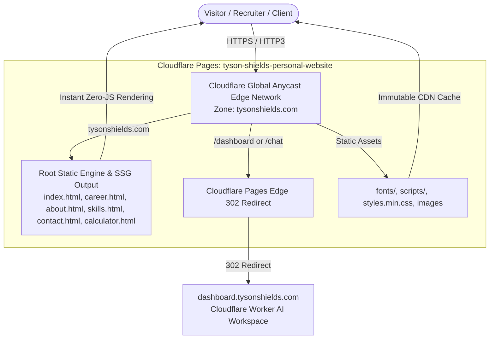

# Tyson Shields Portfolio & Professional Systems

[](package.json)
[](LICENSE)
[](https://pages.cloudflare.com)
[](.eleventy.js)
[](package.json)
[](index.html)

The professional portfolio and technical platform of **Tyson Shields**—Client Service Specialist & Operations Analyst specializing in employee benefits administration, automated workflows (Python/Power Query), and data integrity.

Production target: **[tysonshields.com](https://tysonshields.com)**.

---

## 🏛 System Architecture

The site is engineered for maximum performance, rock-solid stability, zero runtime JavaScript dependency, and instant global edge delivery:



- **Production Static Delivery (Root):** High-speed, zero-dependency static pages (`index.html`, `about.html`, `career.html`, `skills.html`, `contact.html`, `calculator.html`, `Tyson-Shields-Resume.html`, `Tyson-Shields-Resume.pdf`) compiled with esbuild (`styles.min.css`), local Outfit typography, and vanilla progressive enhancement (`scripts/core.js`). Deployed globally via Cloudflare Pages.
- **Eleventy SSG Integration (`.eleventy.js`):** Built-in Eleventy 3.x templating engine supporting modular partials (`_includes/`) and base layouts (`_layouts/`) for compile-time generation into `_site/`.
- **Master Design System & Elevation Engine:** Cybernetic dark-mode elevation scale, WCAG AAA/AA compliant contrast ratios, balanced typography line-heights without character collisions, and elimination of blurry text-shadow halos.

---

## 📂 Directory Layout

```text
Tyson-Shields-Personal-Website/
├── assets/                           # Static media, icons, and document artifacts
│   ├── docs/                         # Document artifacts
│   │   └── Tyson-Shields-Resume.pdf  # Downloadable PDF resume artifact
│   ├── icons/                        # Multi-resolution favicons and PWA icons
│   │   ├── android-chrome-192x192.png
│   │   ├── android-chrome-512x512.png
│   │   ├── apple-touch-icon.png
│   │   ├── favicon-16x16.png
│   │   ├── favicon-32x32.png
│   │   ├── favicon.ico
│   │   └── icon.svg
│   └── images/                       # High-resolution media and OpenGraph cards
│       ├── og-image.png              # Social preview OpenGraph card
│       └── tyson-shields-headshot.jpg# High-resolution executive headshot
├── docs/                             # Architecture blueprints & operational guidelines
│   ├── AGENT_GUIDELINES.md           # Engineering guidelines for developers & AI agents
│   └── ARCHITECTURE.md               # High-level system architecture overview
├── _includes/                        # Eleventy reusable partials (header, footer, drawer)
│   ├── header.html                   # Global accessible navigation bar
│   ├── footer.html                   # Global footer and copyright metadata
│   └── settings-drawer.html          # Appearance & accessibility drawer partial
├── _layouts/                         # Base HTML layouts for static generation
│   └── base.html                     # Base Eleventy layout template
├── fonts/                            # Modern WOFF2 typography (Outfit Latin 400 & 700)
├── scripts/                          # Client-side scripts and Cloudflare CLI tooling
│   ├── core.js                       # Shared UI preferences, theme engine, command palette
│   ├── home.js                       # Interactive homepage canvas, radar simulation & clock
│   ├── contact.js                    # Direct contact modal and clipboard interactions
│   ├── 404.js                        # Dynamic route recovery & countdown engine
│   ├── format-pages.js               # Cross-page header, drawer, and palette synchronizer
│   ├── cf-status.js                  # Cloudflare zone, DNS, and Pages health verifier
│   ├── cf-purge.js                   # Instant worldwide edge cache invalidator
│   └── preview.js                    # Local zero-dependency HTTP preview server
├── .eleventy.js                      # Eleventy SSG configuration and passthrough rules
├── .eleventyignore                   # Exclusions for Eleventy static build
├── .gitignore                        # Git exclusion rules
├── _headers                          # Cloudflare Pages edge HTTP security and caching headers
├── _redirects                        # Cloudflare Pages edge 302/301 routing rules
├── 404.html                          # Not Found page
├── about.html                        # About / Executive Dossier
├── calculator.html                   # Interactive Scientific Calculator
├── career.html                       # Career Chronology & Published Columns
├── contact.html                      # Comms Relay & Direct Contact
├── favicon.ico                       # Root fallback favicon for legacy browsers/crawlers
├── index.html                        # Production Homepage (tysonshields.com)
├── skills.html                       # Technical Competencies Matrix & Certifications
├── Tyson-Shields-Resume.html         # Web-viewable interactive resume
├── styles.css                        # Source cybernetic CSS stylesheet
├── styles.min.css                    # Minified production stylesheet (compiled by esbuild)
├── CLOUDFLARE.md                     # Cloudflare edge routing and CDN configuration
├── site.webmanifest                  # Progressive Web App manifest
├── sitemap.xml & robots.txt          # SEO crawlers and index directives
└── package.json                      # Build scripts and project dependencies
```

---

## ⚡ Core Domain Specializations

- **Employee Benefits Operations:** Portfolio administration across 20+ corporate employer groups, commercial carrier partner liaison (Cigna, Ameritas, Unum, Guardian, Auxiant, Principal, Mutual of Omaha, Assurity, Pacific Life), enrollment discrepancy resolution, and open enrollment management.
- **Census Reconciliation & Data Parity:** Cross-system audits between carrier premium statements, payroll deduction ledgers, and HRIS census files (Employee Navigator, iSolved, Paylocity, ThreeFlow) to ensure audit integrity and roster accuracy.
- **Workflow & Process Automation:** Custom Python (`pandas`) and Power Query scripts that automate multi-carrier census auditing and accelerate reporting cycles.
- **Regulatory Compliance:** Active Nebraska Resident Insurance Producer License in Life and Health (NE DOI License #21707104), enforcing ERISA, HIPAA, COBRA, and ACA statutory standards.
- **Technical Media & Broadcast Operations:** Split-second newsroom pacing across live broadcasts using AP ENPS, robotic camera pedestal programming, teleprompter feed management, and studio audio DSP routing.

---

## 🛠 Local Development & Operational Commands

All development tasks are automated through npm scripts in [`package.json`](file:///c:/Users/tyson/Documents/GitHub/Tyson-Shields-Personal-Website/package.json):

### 1. Minify Production CSS
```bash
npm run build
# Compiles styles.css -> styles.min.css via esbuild in ~25ms
```

### 2. Full Static Site Generator Build (Eleventy)
```bash
npm run build:ssg
# Minifies CSS with esbuild and builds static site into _site/ via @11ty/eleventy
```

### 3. Local Live-Reload Dev Server
```bash
npm run dev
# Starts Eleventy dev server with hot-reload at http://localhost:8080
```

### 4. Static HTTP Preview Server
```bash
npm run preview
# Serves root files directly at http://localhost:8000
```

### 5. Synchronize Page Partials & Modals
```bash
npm run format:pages
# Synchronizes the global header, command palette, and settings drawer across all pages
```

### 6. Cloudflare Edge Status & Diagnostics
```bash
npm run cf:status
# Inspects real-time Cloudflare zone, DNS routing, and Pages deployment health
```

### 7. Cloudflare Global Edge Cache Purge
```bash
npm run cf:purge
# Triggers instant global cache invalidation across all 300+ Cloudflare PoPs
```

For full details on edge caching, security headers, and DNS topology, see **[`CLOUDFLARE.md`](CLOUDFLARE.md)**.

---

## 🎨 Interactive Features & Accessibility Suite

- **Quick Search & Command Palette (`Ctrl+K`):** Universal search and keyboard-driven shortcut modal with fuzzy matching across pages, career history, skills, and downloads.
- **Interactive Scientific Calculator ([calculator.html](calculator.html)):** Lightweight, client-side mathematical evaluation engine supporting trigonometric functions (`sin`, `cos`, `tan`), powers (`x²`), square roots (`√`), logarithms (`log`), and responsive keypads.
- **Display Settings & Appearance Drawer:**
  - **Themes:** Navy (Cyberpunk Blue), Dark (Deep Space), Slate (Graphite), Light (Alabaster), and Reading (Warm Sepia).
  - **Accessibility Overrides:** High-Contrast Mode, OpenDyslexic-inspired legible typography, Text Scaling (Normal, Large, Extra Large), Underline Links, and Reduced Motion toggles.
  - Safe, privacy-hardened `localStorage` fallback protecting private browsing sessions from runtime exceptions.

---

## ☁️ Cloudflare Edge & Ecosystem Integration

- **Production Domain:** `https://tysonshields.com` (Cloudflare Pages)
- **AI Workspace:** `https://dashboard.tysonshields.com` (Cloudflare Worker `dashboard` with Zero Trust Access)
- **Edge Routing & Forwarding:**
  - `_redirects` forwards `/dashboard` and `/chat` directly to `https://dashboard.tysonshields.com`.
  - `_headers` enforces HTTP/3, TLS 1.3 0-RTT, and immutable Cloudflare CDN caching for fonts, images, and minified assets.
  - Automatic minification active at the Cloudflare edge for HTML, CSS, and JS.

---

## 📖 Contributing & AI Agent Instructions

All engineers and automated AI coding assistants **must adhere** to the architectural specifications and content workflows detailed in **[`docs/AGENT_GUIDELINES.md`](docs/AGENT_GUIDELINES.md)**.

### Content Update Rules:
1. **Maintain Semantic Markup**: Keep narrative copy and layout in semantic HTML5 elements (`<main>`, `<header>`, `<article>`, `<section>`).
2. **Recompile CSS**: Always run `npm run build` after editing `styles.css` to regenerate `styles.min.css`.
3. **Preserve SEO JSON-LD schema**: Ensure structured schema data in page headers remains valid and synchronized.
4. **Test Before Commit**: Run `npm run build:ssg` to ensure zero compilation or templating regressions.

---

## 🔄 Autonomous Self-Improvement & Continuous Code Quality

This platform operates on an autonomous self-improving code hygiene model. On every contribution or task, AI models and software engineers must proactively:

- **Continuously Clean & Refactor**: Audit for dead styles, obsolete selectors, orphaned event handlers, and messy formatting across HTML, CSS, and JS.
- **Enforce Blocker & Privacy Immunity**: Audit class names and IDs against ad/content-blocker filter rules (EasyList) to prevent silent cosmetic filtering of legitimate stats, callouts, and docks.
- **Diagnose & Repair Multi-Browser Discrepancies**: Maintain layout parity and visual consistency across Blink (Chrome/Edge/Brave), Gecko (Firefox), and WebKit (Safari), verifying responsive breakpoints and dark/light/reading theme contrast.
- **Fault-Tolerant Runtime Hardening**: Ensure APIs (`localStorage`, clipboard, canvas) have robust fallback handling that gracefully recovers if blocked in private browsing or isolated security sandboxes.
- **Verification Guarantee**: Every change must be validated with `npm run build:ssg` before submission.

For full implementation details, see **[`docs/AGENT_GUIDELINES.md`](docs/AGENT_GUIDELINES.md)**.

---

## 📄 License & Attribution

- Designed and engineered by **Tyson Shields**.
- Code licensed under the [MIT License](LICENSE).
