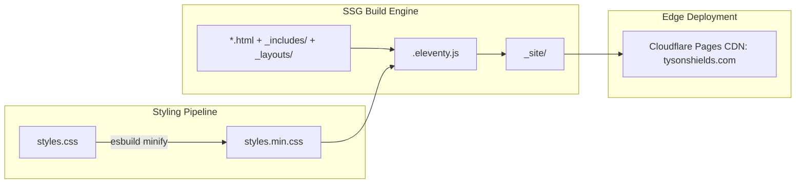

# Project Architecture & Systems Blueprint

## 1. Executive Summary
This repository hosts the professional portfolio and operational systems of **Tyson Shields**, engineered with a high-performance **zero-dependency static delivery architecture**:
1. **Production Static Delivery (Root):** Zero-JS-dependent, high-speed semantic HTML5 pages (`index.html`, `career.html`, `about.html`, `skills.html`, `contact.html`, `calculator.html`, `Tyson-Shields-Resume.html`, `Tyson-Shields-Resume.pdf`), compiled minified CSS (`styles.min.css`), local Outfit typography, and Eleventy static site generation (`.eleventy.js`).
2. **Global Edge Delivery (Cloudflare Pages):** Full Anycast distribution, edge redirects forwarding `/dashboard` and `/chat` to `https://dashboard.tysonshields.com`, and immutable CDN caching headers.
3. **Master Design System & Surface Elevation Scale:** Cybernetic elevation scale (`--surface-1` through `--surface-3`), WCAG AAA/AA compliant contrast, zero blurry neon halos, and typography kerning that prevents character collisions.

---

## 2. Exhaustive Directory Hierarchy

```text
Tyson-Shields-Personal-Website/
├── assets/                           # Static media, icons, and document artifacts
│   ├── docs/                         # Document artifacts
│   │   └── Tyson-Shields-Resume.pdf  # Downloadable PDF resume artifact
│   ├── icons/                        # Multi-resolution favicons and PWA icons
│   │   ├── android-chrome-192x192.png
│   │   ├── android-chrome-512x512.png
│   │   ├── apple-touch-icon.png
│   │   ├── favicon-16x16.png
│   │   ├── favicon-32x32.png
│   │   ├── favicon.ico
│   │   └── icon.svg
│   └── images/                       # High-resolution media and OpenGraph cards
│       ├── og-image.png              # Social preview OpenGraph card
│       └── tyson-shields-headshot.jpg# High-resolution executive headshot
├── docs/                             # Architecture blueprints & operational guidelines
│   ├── AGENT_GUIDELINES.md           # Engineering guidelines for developers & AI agents
│   └── ARCHITECTURE.md               # This high-level systems architecture blueprint
├── _includes/                        # Reusable Eleventy partials (compile-time SSG)
│   ├── header.html                   # Global accessible navigation bar
│   ├── footer.html                   # Global footer, copyright, and telemetry status
│   └── settings-drawer.html          # Appearance & accessibility preference drawer
├── _layouts/                         # Eleventy base HTML layouts
│   └── base.html                     # Base Eleventy layout template
├── fonts/                            # Locally hosted WOFF2 typography (Outfit Latin 400 & 700)
├── scripts/                          # Progressive enhancement scripts & Cloudflare tooling
│   ├── core.js                       # Shared preferences, theme engine, command palette, navigation
│   ├── contact.js                    # Direct contact modal and clipboard interactions
│   ├── 404.js                        # Dynamic route recovery & auto-redirect engine
│   ├── format-pages.js               # Cross-page partial and modal synchronizer
│   ├── cf-status.js                  # Cloudflare zone, DNS, and Pages health verifier
│   ├── cf-purge.js                   # Instant worldwide edge cache invalidator
│   └── preview.js                    # Zero-dependency local HTTP preview server
├── .eleventy.js                      # Eleventy SSG configuration and passthrough rules
├── .eleventyignore                   # Exclusions for Eleventy static build
├── .gitignore                        # Git exclusion rules
├── _headers                          # Cloudflare Pages edge HTTP security and caching headers
├── _redirects                        # Cloudflare Pages edge 302/301 routing rules
├── 404.html                          # Not Found error page
├── about.html                        # Executive Dossier & Dual-Degree Biography
├── calculator.html                   # Interactive Scientific Calculator
├── career.html                       # Career Chronology & Published Columns
├── contact.html                      # Direct Communication Relay
├── favicon.ico                       # Root fallback favicon for legacy browsers/crawlers
├── index.html                        # Production Homepage (tysonshields.com)
├── skills.html                       # Technical Competencies Matrix & Certifications
├── Tyson-Shields-Resume.html         # Web-viewable interactive resume
├── styles.css                        # Source cybernetic CSS stylesheet
├── styles.min.css                    # Production minified stylesheet (esbuild)
├── PROJECT_GUIDE.md                  # Comprehensive engineering blueprint and verified fact base
├── CHANGELOG_AUDIT.md                # Audit changelog, deletions report, and performance records
├── CLOUDFLARE.md                     # Cloudflare edge routing and CDN configuration
├── site.webmanifest                  # Progressive Web App manifest
├── sitemap.xml & robots.txt          # SEO crawlers and index directives
└── package.json                      # Build scripts & dependency declarations
```

---

## 3. Separation of Concerns & System Layers

1. **Semantic Content Layer (`*.html`):** Pre-rendered semantic HTML containing structured text, Schema.org JSON-LD metadata, and accessibility landmarks (`<header>`, `<nav>`, `<main>`, `<article>`, `<section>`, `<footer>`).
2. **Templating Engine (`_includes/` & `_layouts/`):** Reusable partials for header, footer, and navigation managed via Eleventy 3.x with zero runtime overhead.
3. **Styling Pipeline (`styles.css` $\rightarrow$ `styles.min.css`):** Pure CSS custom properties compiled and minified in ~25ms via `esbuild`. Employs CSS custom properties for color tokens, surface elevation, and typography kerning.
4. **Progressive Enhancement (`scripts/`):** Lightweight client scripts for theme toggling, particle effects, and copy interactions with zero framework dependencies.
5. **Edge Delivery Layer (`_headers` & `_redirects`):** Native Cloudflare Pages rules governing HTTP/3 transport, immutable font/image caching, security policies, and 302 forwarding of `/dashboard` and `/chat` to `https://dashboard.tysonshields.com`.

---

## 4. Data Flow & Build Pipeline



---

## 5. Client Runtime & Accessibility Engine (`core.js`)

- **Theme Switching:** Five discrete themes (`navy`, `dark`, `slate`, `light`, `reading`) with CSS variables that adapt contrast, background luminosity, and accent color.
- **Accessibility Suite:** High Contrast mode, OpenDyslexic-inspired legible font toggle, font size scaling (`normal`, `large`, `xlarge`), link underlines, and reduced motion overrides.
- **Command Palette (`Ctrl+K`):** Global modal offering instant keyboard search across site pages, career roles, certifications, and direct contact actions.
- **Privacy Hardening:** Safe wrappers around `localStorage` and `navigator.clipboard` to prevent `SecurityError` exceptions in privacy sandboxes or incognito modes.
